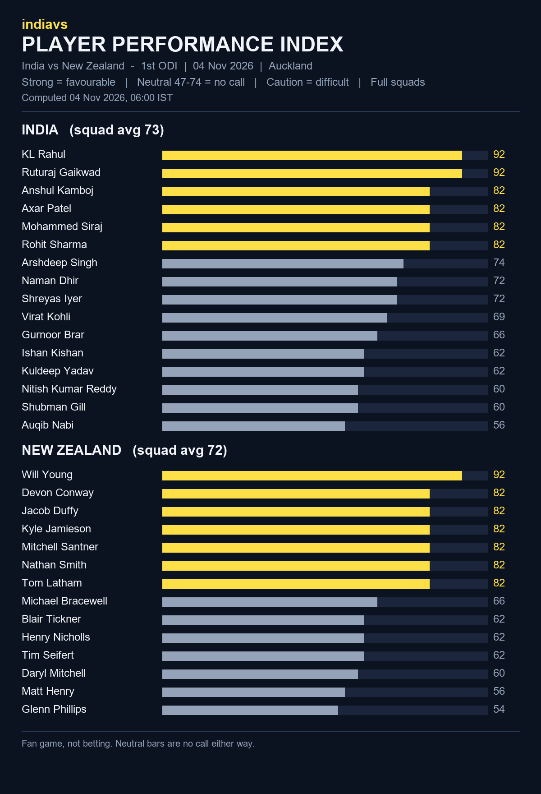

# indiavs Player Performance Index - India vs New Zealand — 1st ODI (India tour of New Zealand 2026)

- **Match:** India vs New Zealand — 1st ODI (India tour of New Zealand 2026), 2026-11-04, 07:30–18:30 IST
- **Venue:** Eden Park, Auckland
- **Computed:** 04 Nov 2026, 06:00 IST (2026-11-04T00:30:02.186503+00:00 UTC)
- **Index version:** v3
- **Rated:** full squads of both teams, not just the playing XI
- **Bands:** strong = favourable, neutral (47-74) = no call, caution = difficult

| File | What it is |
|------|------------|
| README.md | This page: both squads, timestamp and hash |
| player-performance-index.png | The index as a chart |
| form-index-ind-vs-nz-1st-odi-20261104.json | The index data, both full squads |
| room.html | Predictor Room frontend that renders the Index |
| room.js | Predictor Room frontend that renders the Index |
| india_odi.json | Squad rated (birth dates removed for public posting) |
| new_zealand_odi.json | Squad rated (birth dates removed for public posting) |

## India (squad avg 73)

| # | Player | Index | Band |
|---|--------|------:|------|
| 1 | KL Rahul | 92 | strong |
| 2 | Ruturaj Gaikwad | 92 | strong |
| 3 | Anshul Kamboj | 82 | strong |
| 4 | Axar Patel | 82 | strong |
| 5 | Mohammed Siraj | 82 | strong |
| 6 | Rohit Sharma | 82 | strong |
| 7 | Arshdeep Singh | 74 | neutral |
| 8 | Naman Dhir | 72 | neutral |
| 9 | Shreyas Iyer | 72 | neutral |
| 10 | Virat Kohli | 69 | neutral |
| 11 | Gurnoor Brar | 66 | neutral |
| 12 | Ishan Kishan | 62 | neutral |
| 13 | Kuldeep Yadav | 62 | neutral |
| 14 | Nitish Kumar Reddy | 60 | neutral |
| 15 | Shubman Gill | 60 | neutral |
| 16 | Auqib Nabi | 56 | neutral |

## New Zealand (squad avg 72)

| # | Player | Index | Band |
|---|--------|------:|------|
| 1 | Will Young | 92 | strong |
| 2 | Devon Conway | 82 | strong |
| 3 | Jacob Duffy | 82 | strong |
| 4 | Kyle Jamieson | 82 | strong |
| 5 | Mitchell Santner | 82 | strong |
| 6 | Nathan Smith | 82 | strong |
| 7 | Tom Latham | 82 | strong |
| 8 | Michael Bracewell | 66 | neutral |
| 9 | Blair Tickner | 62 | neutral |
| 10 | Henry Nicholls | 62 | neutral |
| 11 | Tim Seifert | 62 | neutral |
| 12 | Daryl Mitchell | 60 | neutral |
| 13 | Matt Henry | 56 | neutral |
| 14 | Glenn Phillips | 54 | neutral |

## Timestamp proof

SHA-256 of `form-index-ind-vs-nz-1st-odi-20261104.json`:

`881aa5a3a3c90a1ef38a701a16dfa8b9201c38b0b950ffa276b180d0d14d6ea6`

Committed before the first ball so the prediction can be checked against the result.
Fan game, not betting.
