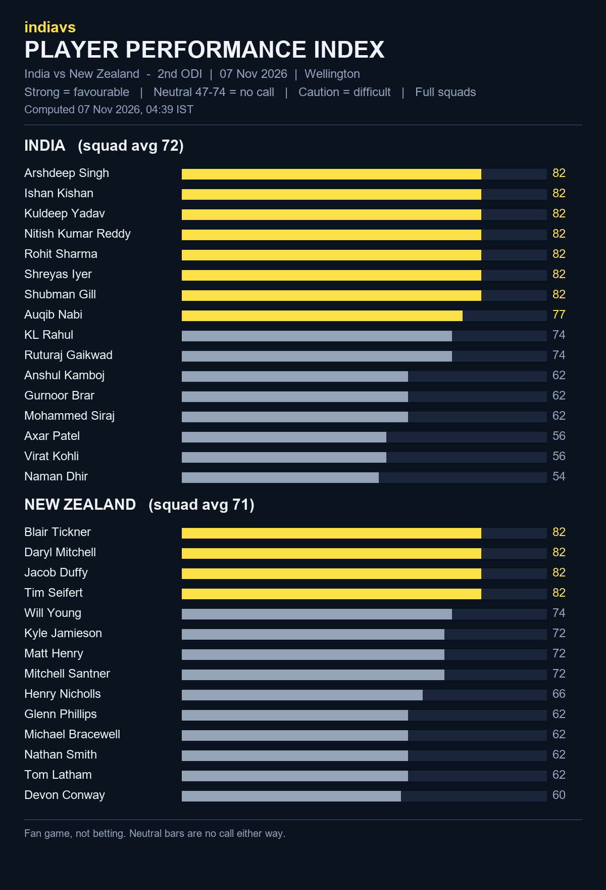

# indiavs Player Performance Index - India vs New Zealand — 2nd ODI (India tour of New Zealand 2026)

- **Match:** India vs New Zealand — 2nd ODI (India tour of New Zealand 2026), 2026-11-07, 07:30–15:30 IST
- **Venue:** Sky Stadium, Wellington
- **Computed:** 07 Nov 2026, 04:39 IST (2026-11-06T23:09:11.685195+00:00 UTC)
- **Index version:** v3
- **Rated:** full squads of both teams, not just the playing XI
- **Bands:** strong = favourable, neutral (47-74) = no call, caution = difficult

| File | What it is |
|------|------------|
| README.md | This page: both squads, timestamp and hash |
| player-performance-index.png | The index as a chart |
| form-index-ind-vs-nz-2nd-odi-20261107.json | The index data, both full squads |
| room.html | Predictor Room frontend that renders the Index |
| room.js | Predictor Room frontend that renders the Index |
| india_odi.json | Squad rated (birth dates removed for public posting) |
| new_zealand_odi.json | Squad rated (birth dates removed for public posting) |

## India (squad avg 72)

| # | Player | Index | Band |
|---|--------|------:|------|
| 1 | Arshdeep Singh | 82 | strong |
| 2 | Ishan Kishan | 82 | strong |
| 3 | Kuldeep Yadav | 82 | strong |
| 4 | Nitish Kumar Reddy | 82 | strong |
| 5 | Rohit Sharma | 82 | strong |
| 6 | Shreyas Iyer | 82 | strong |
| 7 | Shubman Gill | 82 | strong |
| 8 | Auqib Nabi | 77 | strong |
| 9 | KL Rahul | 74 | neutral |
| 10 | Ruturaj Gaikwad | 74 | neutral |
| 11 | Anshul Kamboj | 62 | neutral |
| 12 | Gurnoor Brar | 62 | neutral |
| 13 | Mohammed Siraj | 62 | neutral |
| 14 | Axar Patel | 56 | neutral |
| 15 | Virat Kohli | 56 | neutral |
| 16 | Naman Dhir | 54 | neutral |

## New Zealand (squad avg 71)

| # | Player | Index | Band |
|---|--------|------:|------|
| 1 | Blair Tickner | 82 | strong |
| 2 | Daryl Mitchell | 82 | strong |
| 3 | Jacob Duffy | 82 | strong |
| 4 | Tim Seifert | 82 | strong |
| 5 | Will Young | 74 | neutral |
| 6 | Kyle Jamieson | 72 | neutral |
| 7 | Matt Henry | 72 | neutral |
| 8 | Mitchell Santner | 72 | neutral |
| 9 | Henry Nicholls | 66 | neutral |
| 10 | Glenn Phillips | 62 | neutral |
| 11 | Michael Bracewell | 62 | neutral |
| 12 | Nathan Smith | 62 | neutral |
| 13 | Tom Latham | 62 | neutral |
| 14 | Devon Conway | 60 | neutral |

## Timestamp proof

SHA-256 of `form-index-ind-vs-nz-2nd-odi-20261107.json`:

`29379bfa9443a51c55a9ceda822a743758f39393f079751d083568667a96c0be`

Committed before the first ball so the prediction can be checked against the result.
Fan game, not betting.
