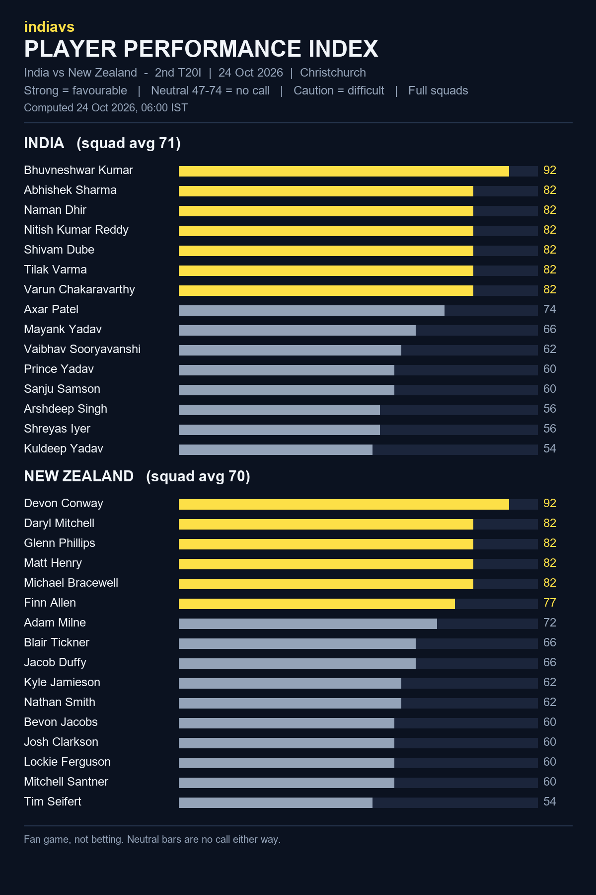

# indiavs Player Performance Index - India vs New Zealand — 2nd T20I (India tour of New Zealand 2026)

- **Match:** India vs New Zealand — 2nd T20I (India tour of New Zealand 2026), 2026-10-24, 12:30–16:00 IST
- **Venue:** Hagley Oval, Christchurch
- **Computed:** 24 Oct 2026, 06:00 IST (2026-10-24T00:30:02.111914+00:00 UTC)
- **Index version:** v3
- **Rated:** full squads of both teams, not just the playing XI
- **Bands:** strong = favourable, neutral (47-74) = no call, caution = difficult

| File | What it is |
|------|------------|
| README.md | This page: both squads, timestamp and hash |
| player-performance-index.png | The index as a chart |
| form-index-ind-vs-nz-2nd-t20i-20261024.json | The index data, both full squads |
| room.html | Predictor Room frontend that renders the Index |
| room.js | Predictor Room frontend that renders the Index |
| india_t20.json | Squad rated (birth dates removed for public posting) |
| new_zealand_t20.json | Squad rated (birth dates removed for public posting) |

## India (squad avg 71)

| # | Player | Index | Band |
|---|--------|------:|------|
| 1 | Bhuvneshwar Kumar | 92 | strong |
| 2 | Abhishek Sharma | 82 | strong |
| 3 | Naman Dhir | 82 | strong |
| 4 | Nitish Kumar Reddy | 82 | strong |
| 5 | Shivam Dube | 82 | strong |
| 6 | Tilak Varma | 82 | strong |
| 7 | Varun Chakaravarthy | 82 | strong |
| 8 | Axar Patel | 74 | neutral |
| 9 | Mayank Yadav | 66 | neutral |
| 10 | Vaibhav Sooryavanshi | 62 | neutral |
| 11 | Prince Yadav | 60 | neutral |
| 12 | Sanju Samson | 60 | neutral |
| 13 | Arshdeep Singh | 56 | neutral |
| 14 | Shreyas Iyer | 56 | neutral |
| 15 | Kuldeep Yadav | 54 | neutral |

## New Zealand (squad avg 70)

| # | Player | Index | Band |
|---|--------|------:|------|
| 1 | Devon Conway | 92 | strong |
| 2 | Daryl Mitchell | 82 | strong |
| 3 | Glenn Phillips | 82 | strong |
| 4 | Matt Henry | 82 | strong |
| 5 | Michael Bracewell | 82 | strong |
| 6 | Finn Allen | 77 | strong |
| 7 | Adam Milne | 72 | neutral |
| 8 | Blair Tickner | 66 | neutral |
| 9 | Jacob Duffy | 66 | neutral |
| 10 | Kyle Jamieson | 62 | neutral |
| 11 | Nathan Smith | 62 | neutral |
| 12 | Bevon Jacobs | 60 | neutral |
| 13 | Josh Clarkson | 60 | neutral |
| 14 | Lockie Ferguson | 60 | neutral |
| 15 | Mitchell Santner | 60 | neutral |
| 16 | Tim Seifert | 54 | neutral |

## Timestamp proof

SHA-256 of `form-index-ind-vs-nz-2nd-t20i-20261024.json`:

`5f7cae5142223eccba42d8229e63e988ade139460423ac2830db2d120b400f6c`

Committed before the first ball so the prediction can be checked against the result.
Fan game, not betting.
