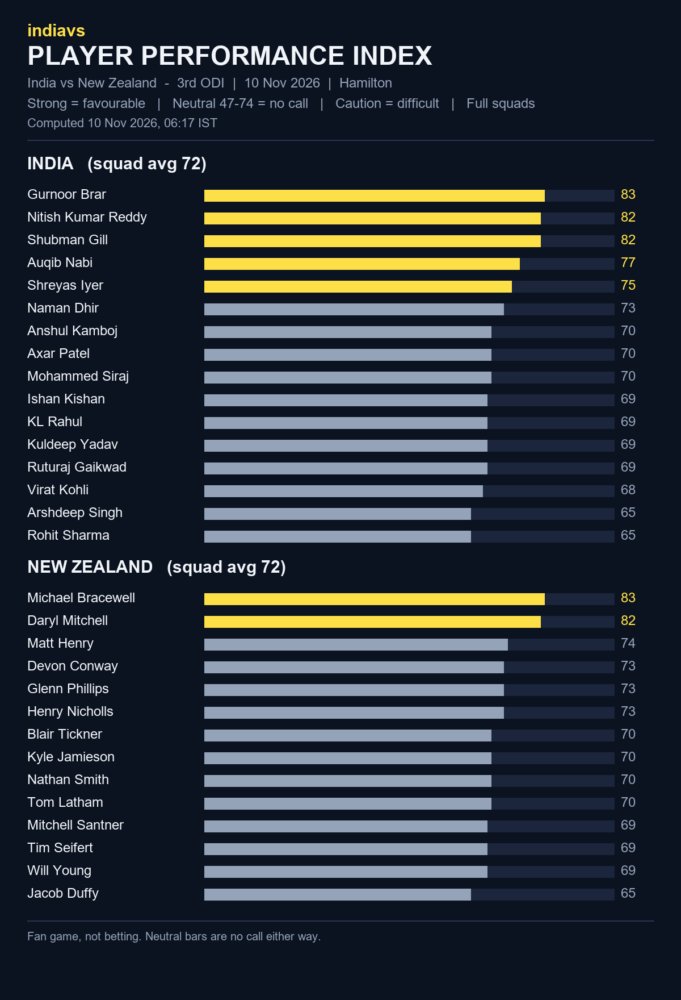

# indiavs Player Performance Index - India vs New Zealand — 3rd ODI (India tour of New Zealand 2026)

- **Match:** India vs New Zealand — 3rd ODI (India tour of New Zealand 2026), 2026-11-10, 07:30–15:30 IST
- **Venue:** Seddon Park, Hamilton
- **Computed:** 10 Nov 2026, 06:17 IST (2026-11-10T00:47:41.930904+00:00 UTC)
- **Index version:** v3
- **Rated:** full squads of both teams, not just the playing XI
- **Bands:** strong = favourable, neutral (47-74) = no call, caution = difficult

| File | What it is |
|------|------------|
| README.md | This page: both squads, timestamp and hash |
| player-performance-index.png | The index as a chart |
| form-index-ind-vs-nz-3rd-odi-20261110.json | The index data, both full squads |
| room.html | Predictor Room frontend that renders the Index |
| room.js | Predictor Room frontend that renders the Index |
| india_odi.json | Squad rated (birth dates removed for public posting) |
| new_zealand_odi.json | Squad rated (birth dates removed for public posting) |

## India (squad avg 72)

| # | Player | Index | Band |
|---|--------|------:|------|
| 1 | Gurnoor Brar | 83 | strong |
| 2 | Nitish Kumar Reddy | 82 | strong |
| 3 | Shubman Gill | 82 | strong |
| 4 | Auqib Nabi | 77 | strong |
| 5 | Shreyas Iyer | 75 | strong |
| 6 | Naman Dhir | 73 | neutral |
| 7 | Anshul Kamboj | 70 | neutral |
| 8 | Axar Patel | 70 | neutral |
| 9 | Mohammed Siraj | 70 | neutral |
| 10 | Ishan Kishan | 69 | neutral |
| 11 | KL Rahul | 69 | neutral |
| 12 | Kuldeep Yadav | 69 | neutral |
| 13 | Ruturaj Gaikwad | 69 | neutral |
| 14 | Virat Kohli | 68 | neutral |
| 15 | Arshdeep Singh | 65 | neutral |
| 16 | Rohit Sharma | 65 | neutral |

## New Zealand (squad avg 72)

| # | Player | Index | Band |
|---|--------|------:|------|
| 1 | Michael Bracewell | 83 | strong |
| 2 | Daryl Mitchell | 82 | strong |
| 3 | Matt Henry | 74 | neutral |
| 4 | Devon Conway | 73 | neutral |
| 5 | Glenn Phillips | 73 | neutral |
| 6 | Henry Nicholls | 73 | neutral |
| 7 | Blair Tickner | 70 | neutral |
| 8 | Kyle Jamieson | 70 | neutral |
| 9 | Nathan Smith | 70 | neutral |
| 10 | Tom Latham | 70 | neutral |
| 11 | Mitchell Santner | 69 | neutral |
| 12 | Tim Seifert | 69 | neutral |
| 13 | Will Young | 69 | neutral |
| 14 | Jacob Duffy | 65 | neutral |

## Timestamp proof

SHA-256 of `form-index-ind-vs-nz-3rd-odi-20261110.json`:

`1f0faea41a504cd87b0ab100cc7c8cc390818befc24a5c84f751d0b9b70b52f7`

Committed before the first ball so the prediction can be checked against the result.
Fan game, not betting.
