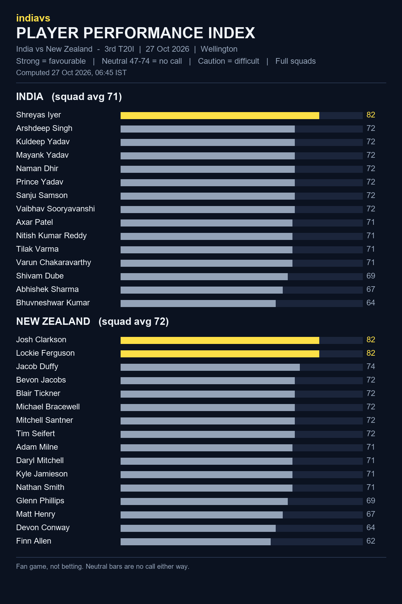

# indiavs Player Performance Index - India vs New Zealand — 3rd T20I (India tour of New Zealand 2026)

- **Match:** India vs New Zealand — 3rd T20I (India tour of New Zealand 2026), 2026-10-27, 12:30–16:00 IST
- **Venue:** Sky Stadium, Wellington
- **Computed:** 27 Oct 2026, 06:45 IST (2026-10-27T01:15:17.344378+00:00 UTC)
- **Index version:** v3
- **Rated:** full squads of both teams, not just the playing XI
- **Bands:** strong = favourable, neutral (47-74) = no call, caution = difficult

| File | What it is |
|------|------------|
| README.md | This page: both squads, timestamp and hash |
| player-performance-index.png | The index as a chart |
| form-index-ind-vs-nz-3rd-t20i-20261027.json | The index data, both full squads |
| room.html | Predictor Room frontend that renders the Index |
| room.js | Predictor Room frontend that renders the Index |
| india_t20.json | Squad rated (birth dates removed for public posting) |
| new_zealand_t20.json | Squad rated (birth dates removed for public posting) |

## India (squad avg 71)

| # | Player | Index | Band |
|---|--------|------:|------|
| 1 | Shreyas Iyer | 82 | strong |
| 2 | Arshdeep Singh | 72 | neutral |
| 3 | Kuldeep Yadav | 72 | neutral |
| 4 | Mayank Yadav | 72 | neutral |
| 5 | Naman Dhir | 72 | neutral |
| 6 | Prince Yadav | 72 | neutral |
| 7 | Sanju Samson | 72 | neutral |
| 8 | Vaibhav Sooryavanshi | 72 | neutral |
| 9 | Axar Patel | 71 | neutral |
| 10 | Nitish Kumar Reddy | 71 | neutral |
| 11 | Tilak Varma | 71 | neutral |
| 12 | Varun Chakaravarthy | 71 | neutral |
| 13 | Shivam Dube | 69 | neutral |
| 14 | Abhishek Sharma | 67 | neutral |
| 15 | Bhuvneshwar Kumar | 64 | neutral |

## New Zealand (squad avg 72)

| # | Player | Index | Band |
|---|--------|------:|------|
| 1 | Josh Clarkson | 82 | strong |
| 2 | Lockie Ferguson | 82 | strong |
| 3 | Jacob Duffy | 74 | neutral |
| 4 | Bevon Jacobs | 72 | neutral |
| 5 | Blair Tickner | 72 | neutral |
| 6 | Michael Bracewell | 72 | neutral |
| 7 | Mitchell Santner | 72 | neutral |
| 8 | Tim Seifert | 72 | neutral |
| 9 | Adam Milne | 71 | neutral |
| 10 | Daryl Mitchell | 71 | neutral |
| 11 | Kyle Jamieson | 71 | neutral |
| 12 | Nathan Smith | 71 | neutral |
| 13 | Glenn Phillips | 69 | neutral |
| 14 | Matt Henry | 67 | neutral |
| 15 | Devon Conway | 64 | neutral |
| 16 | Finn Allen | 62 | neutral |

## Timestamp proof

SHA-256 of `form-index-ind-vs-nz-3rd-t20i-20261027.json`:

`e7e95567602e9befad783512d65548357978c89b64ee0044c57995ac78c4925d`

Committed before the first ball so the prediction can be checked against the result.
Fan game, not betting.
