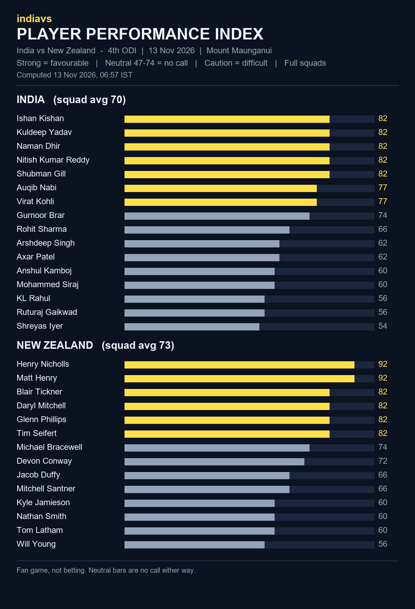

# indiavs Player Performance Index - India vs New Zealand — 4th ODI (India tour of New Zealand 2026)

- **Match:** India vs New Zealand — 4th ODI (India tour of New Zealand 2026), 2026-11-13, 07:30–15:30 IST
- **Venue:** Bay Oval, Mount Maunganui
- **Computed:** 13 Nov 2026, 06:57 IST (2026-11-13T01:27:19.580923+00:00 UTC)
- **Index version:** v3
- **Rated:** full squads of both teams, not just the playing XI
- **Bands:** strong = favourable, neutral (47-74) = no call, caution = difficult

| File | What it is |
|------|------------|
| README.md | This page: both squads, timestamp and hash |
| player-performance-index.png | The index as a chart |
| form-index-ind-vs-nz-4th-odi-20261113.json | The index data, both full squads |
| room.html | Predictor Room frontend that renders the Index |
| room.js | Predictor Room frontend that renders the Index |
| india_odi.json | Squad rated (birth dates removed for public posting) |
| new_zealand_odi.json | Squad rated (birth dates removed for public posting) |

## India (squad avg 70)

| # | Player | Index | Band |
|---|--------|------:|------|
| 1 | Ishan Kishan | 82 | strong |
| 2 | Kuldeep Yadav | 82 | strong |
| 3 | Naman Dhir | 82 | strong |
| 4 | Nitish Kumar Reddy | 82 | strong |
| 5 | Shubman Gill | 82 | strong |
| 6 | Auqib Nabi | 77 | strong |
| 7 | Virat Kohli | 77 | strong |
| 8 | Gurnoor Brar | 74 | neutral |
| 9 | Rohit Sharma | 66 | neutral |
| 10 | Arshdeep Singh | 62 | neutral |
| 11 | Axar Patel | 62 | neutral |
| 12 | Anshul Kamboj | 60 | neutral |
| 13 | Mohammed Siraj | 60 | neutral |
| 14 | KL Rahul | 56 | neutral |
| 15 | Ruturaj Gaikwad | 56 | neutral |
| 16 | Shreyas Iyer | 54 | neutral |

## New Zealand (squad avg 73)

| # | Player | Index | Band |
|---|--------|------:|------|
| 1 | Henry Nicholls | 92 | strong |
| 2 | Matt Henry | 92 | strong |
| 3 | Blair Tickner | 82 | strong |
| 4 | Daryl Mitchell | 82 | strong |
| 5 | Glenn Phillips | 82 | strong |
| 6 | Tim Seifert | 82 | strong |
| 7 | Michael Bracewell | 74 | neutral |
| 8 | Devon Conway | 72 | neutral |
| 9 | Jacob Duffy | 66 | neutral |
| 10 | Mitchell Santner | 66 | neutral |
| 11 | Kyle Jamieson | 60 | neutral |
| 12 | Nathan Smith | 60 | neutral |
| 13 | Tom Latham | 60 | neutral |
| 14 | Will Young | 56 | neutral |

## Timestamp proof

SHA-256 of `form-index-ind-vs-nz-4th-odi-20261113.json`:

`874ded9234d63e5e41d620a148bd802e3949e3f025989e7178e2d5ec7abf585e`

Committed before the first ball so the prediction can be checked against the result.
Fan game, not betting.
