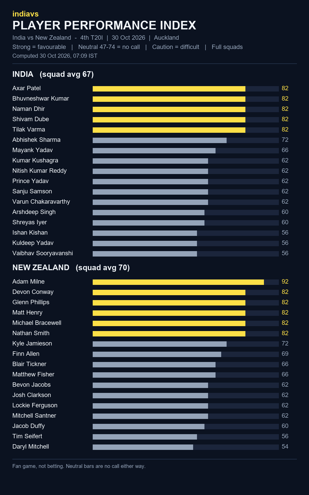

# indiavs Player Performance Index - India vs New Zealand — 4th T20I (India tour of New Zealand 2026)

- **Match:** India vs New Zealand — 4th T20I (India tour of New Zealand 2026), 2026-10-30, 12:30–16:00 IST
- **Venue:** Eden Park, Auckland
- **Computed:** 30 Oct 2026, 07:09 IST (2026-10-30T01:39:36.229448+00:00 UTC)
- **Index version:** v3
- **Rated:** full squads of both teams, not just the playing XI
- **Bands:** strong = favourable, neutral (47-74) = no call, caution = difficult

| File | What it is |
|------|------------|
| README.md | This page: both squads, timestamp and hash |
| player-performance-index.png | The index as a chart |
| form-index-ind-vs-nz-4th-t20i-20261030.json | The index data, both full squads |
| room.html | Predictor Room frontend that renders the Index |
| room.js | Predictor Room frontend that renders the Index |
| india_t20.json | Squad rated (birth dates removed for public posting) |
| new_zealand_t20.json | Squad rated (birth dates removed for public posting) |

## India (squad avg 67)

| # | Player | Index | Band |
|---|--------|------:|------|
| 1 | Axar Patel | 82 | strong |
| 2 | Bhuvneshwar Kumar | 82 | strong |
| 3 | Naman Dhir | 82 | strong |
| 4 | Shivam Dube | 82 | strong |
| 5 | Tilak Varma | 82 | strong |
| 6 | Abhishek Sharma | 72 | neutral |
| 7 | Mayank Yadav | 66 | neutral |
| 8 | Kumar Kushagra | 62 | neutral |
| 9 | Nitish Kumar Reddy | 62 | neutral |
| 10 | Prince Yadav | 62 | neutral |
| 11 | Sanju Samson | 62 | neutral |
| 12 | Varun Chakaravarthy | 62 | neutral |
| 13 | Arshdeep Singh | 60 | neutral |
| 14 | Shreyas Iyer | 60 | neutral |
| 15 | Ishan Kishan | 56 | neutral |
| 16 | Kuldeep Yadav | 56 | neutral |
| 17 | Vaibhav Sooryavanshi | 56 | neutral |

## New Zealand (squad avg 70)

| # | Player | Index | Band |
|---|--------|------:|------|
| 1 | Adam Milne | 92 | strong |
| 2 | Devon Conway | 82 | strong |
| 3 | Glenn Phillips | 82 | strong |
| 4 | Matt Henry | 82 | strong |
| 5 | Michael Bracewell | 82 | strong |
| 6 | Nathan Smith | 82 | strong |
| 7 | Kyle Jamieson | 72 | neutral |
| 8 | Finn Allen | 69 | neutral |
| 9 | Blair Tickner | 66 | neutral |
| 10 | Matthew Fisher | 66 | neutral |
| 11 | Bevon Jacobs | 62 | neutral |
| 12 | Josh Clarkson | 62 | neutral |
| 13 | Lockie Ferguson | 62 | neutral |
| 14 | Mitchell Santner | 62 | neutral |
| 15 | Jacob Duffy | 60 | neutral |
| 16 | Tim Seifert | 56 | neutral |
| 17 | Daryl Mitchell | 54 | neutral |

## Timestamp proof

SHA-256 of `form-index-ind-vs-nz-4th-t20i-20261030.json`:

`9f78eae15fc833e56aa975224a2b793aa454b054cf84819b6f43241a4c45c74e`

Committed before the first ball so the prediction can be checked against the result.
Fan game, not betting.
