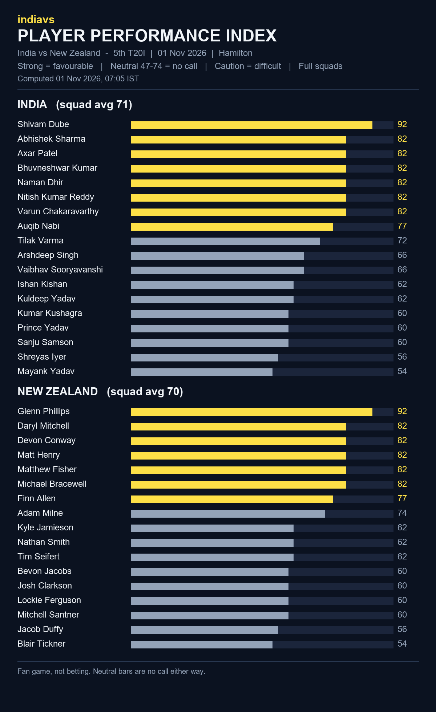

# indiavs Player Performance Index - India vs New Zealand — 5th T20I (India tour of New Zealand 2026)

- **Match:** India vs New Zealand — 5th T20I (India tour of New Zealand 2026), 2026-11-01, 12:30–16:00 IST
- **Venue:** Seddon Park, Hamilton
- **Computed:** 01 Nov 2026, 07:05 IST (2026-11-01T01:35:02.481853+00:00 UTC)
- **Index version:** v3
- **Rated:** full squads of both teams, not just the playing XI
- **Bands:** strong = favourable, neutral (47-74) = no call, caution = difficult

| File | What it is |
|------|------------|
| README.md | This page: both squads, timestamp and hash |
| player-performance-index.png | The index as a chart |
| form-index-ind-vs-nz-5th-t20i-20261101.json | The index data, both full squads |
| room.html | Predictor Room frontend that renders the Index |
| room.js | Predictor Room frontend that renders the Index |
| india_t20.json | Squad rated (birth dates removed for public posting) |
| new_zealand_t20.json | Squad rated (birth dates removed for public posting) |

## India (squad avg 71)

| # | Player | Index | Band |
|---|--------|------:|------|
| 1 | Shivam Dube | 92 | strong |
| 2 | Abhishek Sharma | 82 | strong |
| 3 | Axar Patel | 82 | strong |
| 4 | Bhuvneshwar Kumar | 82 | strong |
| 5 | Naman Dhir | 82 | strong |
| 6 | Nitish Kumar Reddy | 82 | strong |
| 7 | Varun Chakaravarthy | 82 | strong |
| 8 | Auqib Nabi | 77 | strong |
| 9 | Tilak Varma | 72 | neutral |
| 10 | Arshdeep Singh | 66 | neutral |
| 11 | Vaibhav Sooryavanshi | 66 | neutral |
| 12 | Ishan Kishan | 62 | neutral |
| 13 | Kuldeep Yadav | 62 | neutral |
| 14 | Kumar Kushagra | 60 | neutral |
| 15 | Prince Yadav | 60 | neutral |
| 16 | Sanju Samson | 60 | neutral |
| 17 | Shreyas Iyer | 56 | neutral |
| 18 | Mayank Yadav | 54 | neutral |

## New Zealand (squad avg 70)

| # | Player | Index | Band |
|---|--------|------:|------|
| 1 | Glenn Phillips | 92 | strong |
| 2 | Daryl Mitchell | 82 | strong |
| 3 | Devon Conway | 82 | strong |
| 4 | Matt Henry | 82 | strong |
| 5 | Matthew Fisher | 82 | strong |
| 6 | Michael Bracewell | 82 | strong |
| 7 | Finn Allen | 77 | strong |
| 8 | Adam Milne | 74 | neutral |
| 9 | Kyle Jamieson | 62 | neutral |
| 10 | Nathan Smith | 62 | neutral |
| 11 | Tim Seifert | 62 | neutral |
| 12 | Bevon Jacobs | 60 | neutral |
| 13 | Josh Clarkson | 60 | neutral |
| 14 | Lockie Ferguson | 60 | neutral |
| 15 | Mitchell Santner | 60 | neutral |
| 16 | Jacob Duffy | 56 | neutral |
| 17 | Blair Tickner | 54 | neutral |

## Timestamp proof

SHA-256 of `form-index-ind-vs-nz-5th-t20i-20261101.json`:

`fa12bf83698df0d8fd8c786cff1f7faa1313a1fe3a13b92bb1150ed3f42da104`

Committed before the first ball so the prediction can be checked against the result.
Fan game, not betting.
